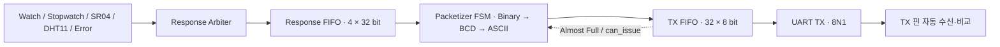

# UART 송신부 RTL 설계·검증

시계·스톱워치·거리·온습도 응답을 ASCII 패킷으로 변환하고 UART로 전송하는 RTL 프로젝트입니다. 응답 중재부터 직렬 TX 출력까지 연결하고, **기대값과 실제 출력의 자동 비교**로 데이터 내용·순서·흐름 제어를 확인합니다.

**Verilog · FSM · FIFO · Double Dabble · UART 8N1 · Vivado XSim · Python**

[설계 구조](docs/architecture.md) · [검증 항목과 재현 방법](docs/verification.md) · [검증 결과](results/summary.txt) · [RTL](rtl) · [테스트벤치](tb)

## 핵심 내용

- **응답 중재**: 여러 입력의 우선순위를 결정하고 32비트 응답 프레임을 FIFO에 저장합니다.
- **패킷 생성**: FSM과 Double Dabble로 이진 데이터를 BCD·ASCII로 변환하고 정상·에러 메시지를 출력합니다.
- **흐름 제어**: TX FIFO의 Almost Full로 한 클록 늦게 도착하는 쓰기를 위한 공간을 확보합니다.
- **자동 검증**: 프레임·BCD·ASCII 단위 비교에 이어 실제 TX 핀을 샘플링하는 송신 경로 E2E 검증을 수행합니다.

## 데이터 흐름



## 검증 결과

실행별 결과와 입력 파일 SHA-256은 [summary.json](results/summary.json)에 기록합니다. 아래 수치는 포함된 테스트벤치의 통과 기준입니다.

| 검증 단계 | 확인 내용 | 통과 기준 |
| --- | --- | --- |
| 응답 프레임 | 정상 408건 + 에러 코드 1~8 | 416건, 실패 0 |
| Binary → BCD | 9비트 입력 0~511 전수 비교 | 512건, 실패 0 |
| ASCII 패킷 | 정상 408건 + 에러·기본 분기 9건 | 417건, 실패 0 |
| UART TX E2E | 정상 20 + 에러 8패킷, 데이터·순서·Stop bit | 28패킷 / 504바이트, 실패 0 |
| 제어·경계 조건 | 중재, 정지·재개, 거리·에러 FSM, FIFO 전달 | 각 테스트의 오류 0 |
| Full / Almost Full 비교 | 동일 입력으로 지연된 쓰기의 유실 재현 | Full: 1바이트 유실 / Almost Full: 유실 0 |

## 주요 설계 이슈: FIFO Full 경계의 1바이트 유실

Packetizer의 ASCII 데이터와 valid는 레지스터를 거쳐 출력됩니다. FIFO가 가득 차는 클록에 이미 결정된 다음 쓰기가 도착할 수 있어, Full만으로 발행을 제어하면 마지막 바이트가 유실됩니다.

현재 연결은 `o_tx_can_issue = ~w_fifo_tx_almost_full`을 사용합니다. 한 칸이 남았을 때 다음 발행을 멈춰 이미 진행 중인 쓰기를 수용합니다. [비교 테스트벤치](tb/tb_almost_compare.v)는 Full 방식과 Almost Full 방식을 나란히 실행해 차이를 재현합니다.

## 실행

필요 환경: **Python 3.10 이상, Windows, Vivado 2020.2 XSim**. Python 외부 패키지는 필요하지 않습니다.

```powershell
git clone https://github.com/didal11/portfolio.git
cd portfolio
$env:VIVADO_BIN = 'C:\Xilinx\Vivado\2020.2\bin'  # 실제 설치 경로로 변경
python run.py
```

특정 검증만 실행할 수도 있습니다.

```powershell
python run.py tb_tx_e2e_auto tb_almost_compare
```

전체 실행은 `results/summary.txt`, `results/summary.json`을 갱신합니다. 일부 테스트 실행은 `results/selected_summary.*`에 기록해 전체 결과와 구분합니다. 컴파일·시뮬레이션 실패, 결과 누락, 비교 실패는 종료 코드 1로 처리합니다.

## 파일 구성

```text
portfolio/
├── rtl/                 # 중재기, Packetizer, FIFO, UART TX/RX, Baud tick
├── tb/                  # 자동 비교·제어·경계 조건 테스트벤치 10개
├── docs/
│   ├── architecture.md  # 데이터 형식, 우선순위, 핸드셰이크
│   └── verification.md  # 검증 매트릭스, 실행·판정·범위
├── results/             # 재현 실행 요약과 입력 파일 해시
└── run.py               # Vivado batch 실행 및 결과 판정
```

## 검증 범위

공개 범위는 **송신부 RTL과 시뮬레이션 검증**입니다. 명령 디코더, 센서 측정 회로, FND를 포함한 전체 시스템과 UART RX 수신 경로는 이번 검증 대상에 포함하지 않습니다. 보드 실측, 합성 자원량, 타이밍 클로저, UVM·기능 커버리지 수치는 이 저장소에서 보고하지 않습니다.

RTL·테스트벤치는 로컬 `TX_TB_20261103` 정리본을 기준으로 구성했습니다. 해당 정리본의 회로 동작과 테스트 자극을 유지하고, 공개 문서와 실행·결과 관리 구조를 추가했습니다.
